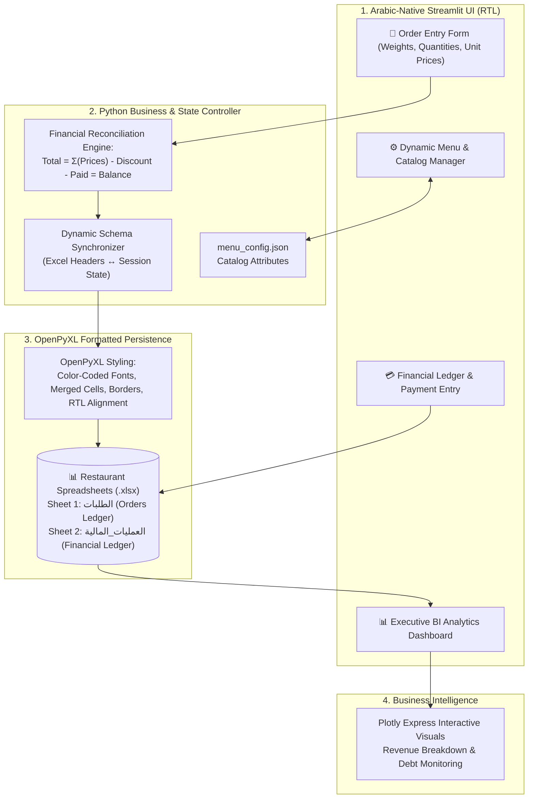

# 🍽️ Restaurant Order & Financial Management System
### نظام إدارة وتسجيل طلبات وحسابات المطاعم

[](https://python.org)
[](https://streamlit.io)
[](https://pandas.pydata.org)
[](https://openpyxl.readthedocs.io)
[](https://plotly.com)
[](https://opensource.org/licenses/MIT)

A commercial, production-ready Arabic-native order registration, financial tracking, and business intelligence desktop web application built for food and beverage suppliers, central kitchens, and multi-branch restaurants. Powered by **Python, Streamlit, Pandas, OpenPyXL, and Plotly**, with automated dual-sheet formatted Excel report generation and real-time ledger reconciliation.

---

## 📌 Project Overview & Problem Statement
Commercial food distributors and wholesale kitchen suppliers manage daily high-velocity order dispatches to dozens of restaurant clients. Traditional manual bookkeeping or generic point-of-sale systems suffer from:
1. **Dynamic Item Attributes**: Inability to seamlessly handle mixed product types (some items sold by weight in kilograms, others by unit count, each paired with dynamic pricing).
2. **Disconnected Ledgers**: Separate tracking of daily food dispatches versus cash collections and deferred credit balances.
3. **Complex Report Formatting**: Manual generation of formatted invoices and audit sheets in Arabic with right-to-left (RTL) alignments.

**This Application** delivers an integrated, zero-friction operational solution:
* **Custom RTL Dark-Themed UI**: Native Arabic interface with right-to-left layout and responsive sidebar navigation.
* **Dynamic Catalog Engine**: Real-time addition, removal, and modification of item attributes (weight, count, unit price) backed by JSON configuration.
* **Dual-Sheet Excel Accounting**: Automated generation of styled, color-coded `.xlsx` workbooks containing an itemized `الطلبات` (Orders) sheet and a financial `العمليات_المالية` (Ledger) sheet.
* **Executive Analytics**: Real-time metric scorecards and interactive Plotly visualizations analyzing cross-restaurant revenue, customer collections, and outstanding debt.

---

## 🏗️ Architecture & Data Pipeline



---

## 🌟 Key Features & Capabilities

### 1. Dynamic Catalog Configuration (`menu_config.json`)
Allows operators to configure and dynamically expand product catalogs without modifying application source code:
* Product specifications can accept combinations of **وزن (Weight)**, **عدد (Count/Quantity)**, and **سعر (Price)**.
* Live global catalog adjustments automatically propagate to newly generated restaurant workbooks.

### 2. Multi-Restaurant Accounting & Isolation
Maintains isolated, dedicated workbooks per restaurant establishment:
* `مطعم بيت الشاورما - اربد.xlsx`
* `مطعم بيت الشاورما - قميم.xlsx`
* `مطعم DUST & DIP.xlsx`
* `مطعم ZONK.xlsx`
* `أهالينا.xlsx`
* `جمال الدين - الاغوار.xlsx`
* `جيت.xlsx`

### 3. OpenPyXL Automated Styling Engine
Programmatically produces accounting-grade Excel spreadsheets adhering to strict visual guidelines:
* **Arabic RTL Sheet View**: Automatically sets `sheet_view.rightToLeft = True`.
* **Multi-Level Headers**: Merges restaurant branding across row 1, static metadata across rows 2–3, and product dynamic headers with custom background fills (`#E6B8B7`).
* **Color-Coded Financial Typography**:
  * **Red Bold Font**: Total order revenue and remaining debt (`المتبقي`).
  * **Green Bold Font**: Amounts paid (`المدفوع`).
  * **Blue Bold Font**: Applied discounts (`الخصم`).
* **Safe File I/O Management**: Explicit workbook handle closures and `PermissionError` traps to prevent file lock crashes if an operator has Excel open concurrently.

### 4. Financial Ledger & Credit Reconciliation
Features a secondary financial tracking sheet (`العمليات_المالية`) tracking non-invoice cash flows:
* Record deferred debt settlements, cash advances, customer discounts, and ledger notes.
* Aggregates total order sales with ledger payments to compute true real-time net receivable balances.

### 5. Interactive BI Analytics Dashboard
* **High-Level KPIs**: Total Gross Sales, Total Discounts, Total Cash Collected, and Total Outstanding Receivables.
* **Visual Breakdown**: Dynamic Plotly Express charts comparing sales volume by restaurant client and monitoring outstanding debt aging.

### 6. Automated Batch Supervisors
Equipped with Windows batch automation scripts for one-click launching:
* `run_app.bat`: Starts the Streamlit application in headless mode on `localhost:8501`.
* `start_system.bat`: Automatically activates virtual environments and boots the dashboard.

---

## 🎯 Role-Specific Technical Evidence

### 🔧 Role 1 Fit: IT System Administrator & Cloud Infrastructure
* **Automation & Process Orchestration**: Built production batch scripts (`run_app.bat`, `start_system.bat`) enabling unattended background service restarts and automated runtime environment activation.
* **Safe File Descriptor & Lock Management**: Refactored openpyxl workbook handlers with explicit `.close()` routines and deterministic write-replaces, resolving Windows file-lock contention and memory leaks.
* **Internal Tool Provisioning**: Packaged the system for low-overhead on-premise execution or deployment to internal Linux/Windows cloud compute instances.

### 🧪 Role 2 Fit: Software Quality Assurance (QA) & Testing
* **Cent-Level Financial Logic Verification**: Programmatically verified mathematical reconciliation formulas (`Total - Paid - Discount = Remaining`) ensuring zero rounding discrepancies across thousands of transaction lines.
* **Defensive Schema Synchronization**: Implemented dynamic schema migration (`sync_config_with_excel`) ensuring that adding new catalog items to existing workbooks preserves existing historical records without column misalignment.
* **Defensive Boundary & Input Validation**: Validated numerical input constraints, ensuring empty or non-numeric entries default safely to `0.0` without triggering unhandled runtime exceptions.

---

## 📁 Repository Structure

```text
├── app.py                          # Core Streamlit application & OpenPyXL engine (587 LOC)
├── menu_config.json                # Dynamic catalog definition file
├── requirements.txt                # Python dependencies (Streamlit, Pandas, OpenPyXL, Plotly)
├── run_app.bat                     # Windows batch launcher script
├── start_system.bat                # Automated system supervisor script
├── .gitignore                      # Tailored exclusion rules for archives, venvs, and logs
├── README.md                       # Comprehensive documentation & architecture guide
└── *.xlsx                          # Client restaurant accounting workbooks
```

---

## 🚀 Setup & Execution Guide

### Prerequisites
* Python 3.10 or 3.11 installed
* Windows 10/11 or Linux OS

### 1. Clone the Repository
```bash
git clone https://github.com/ahmadrashed2589-hue/restaurant-order-system.git
cd restaurant-order-system
```

### 2. Install Dependencies
```bash
pip install -r requirements.txt
```

### 3. Launch the Application
You can launch the dashboard using either the Python CLI or the batch launcher:

**Via Terminal:**
```bash
streamlit run app.py
```

**Via Windows Batch Script:**
Double-click `run_app.bat` or `start_system.bat`.

Once launched, navigate to `http://localhost:8501` in your web browser.
